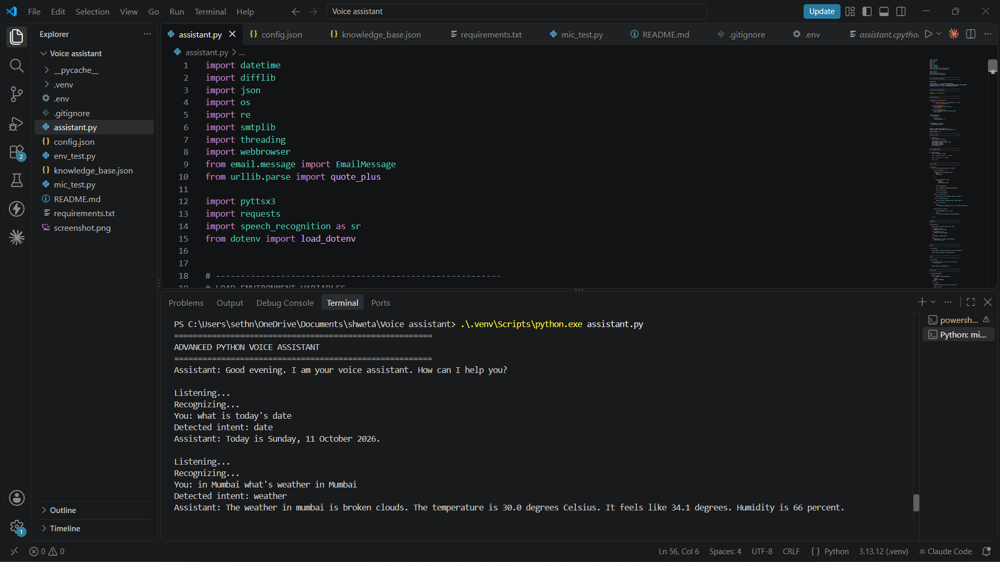

# 🎙️ Advanced Python Voice Assistant

A Python-based voice assistant that listens to spoken commands, understands supported requests, and responds using text-to-speech. This project was developed for the **Oasis Infobyte Python Programming Internship**.

## Features

- Voice input using a microphone and spoken responses using text-to-speech.
- Time-based greetings, current time, and date.
- Voice-controlled Google web search.
- Speech recognition error handling.
- Rule-based command and intent detection.
- Email sending through Gmail using an App Password and saved contacts.
- Reminders with durations in seconds, minutes, or hours.
- Live weather updates using the OpenWeatherMap API.
- Local knowledge base with exact, partial, and fuzzy question matching.
- Custom commands loaded from a JSON configuration file, including spoken responses and website opening.

## Screenshots

### 1. Assistant Greeting and Question Responses

Shows the assistant starting successfully and responding to spoken questions.



### 2. Weather and Additional Features

Shows an example of the assistant providing a weather report or responding to another supported command.


## Technologies Used

- Python
- SpeechRecognition
- pyttsx3
- Requests
- smtplib and email
- Threading
- difflib
- python-dotenv
- JSON

## Requirements

- Python 3.10 or a compatible version supported by the required libraries.
- A working microphone and speakers or headphones.
- An internet connection for speech recognition, weather updates, web searches, and email sending.
- A Google App Password for the email feature.
- An OpenWeatherMap API key for weather updates.

## Setup and Installation

### 1. Clone the repository

```bash
git clone <your-repository-url>
cd Python-Task1-VoiceAssistant
```

### 2. Create a virtual environment

```bash
python -m venv .venv
```

Activate it on Windows:

```powershell
.venv\Scripts\activate
```

### 3. Install dependencies

```bash
pip install -r requirements.txt
```

Microphone support may require a compatible PyAudio installation.

### 4. Configure environment variables

Create a `.env` file in the project folder:

```text
ASSISTANT_EMAIL=your_email@gmail.com
ASSISTANT_EMAIL_APP_PASSWORD=your_16_character_app_password
OPENWEATHER_API_KEY=your_api_key
```

Use a Google App Password rather than your normal Gmail password. The weather API key is required only for weather functionality.

**Important:** Never upload `.env` or share your passwords or API keys publicly.

### 5. Configure contacts and commands

Edit `config.json` to add your own contacts and custom commands. Update `knowledge_base.json` with your preferred question-and-answer pairs.

### 6. Run the assistant

```bash
python assistant.py
```

## Example Voice Commands

| Command | Function |
|---|---|
| "Hello" | Greets the user |
| "What time is it?" | Announces the current time |
| "What's today's date?" | Announces the date |
| "Search for Python tutorials" | Opens a Google search |
| "What's the weather in Mumbai?" | Provides weather information |
| "Send an email" | Starts the email workflow |
| "Remind me in 10 seconds to drink water" | Sets a reminder |
| "What is Python?" | Searches the local knowledge base |
| "Tell me a joke" | Runs a configured custom command |
| "Open GitHub" | Opens a configured website |
| "Stop" | Closes the assistant |

Some commands must match the phrases supported by the intent detector or the custom commands in `config.json`.

## Privacy and Security

- Microphone audio is sent to Google's speech recognition service for transcription and is not saved to disk by this application.
- Email credentials and the weather API key are loaded from environment variables.
- Email messages are sent through Gmail's encrypted SMTP connection.
- The contacts list, custom commands, and knowledge base are stored in local JSON files.
- The application does not save conversation history between runs.

## Known Limitations

- Speech recognition accuracy depends on microphone quality, background noise, internet connectivity, and speaking clarity.
- The assistant may need a command repeated if it does not recognize the speech.
- Email recipients must already be configured in `config.json`.
- Intent detection uses predefined phrases rather than a trained natural language processing model.
- Reminders work only while the application is running and may be announced a few seconds after the scheduled time.
- The microphone device index may need to be adjusted for different computers.

## Author

**Shweta Soni**

